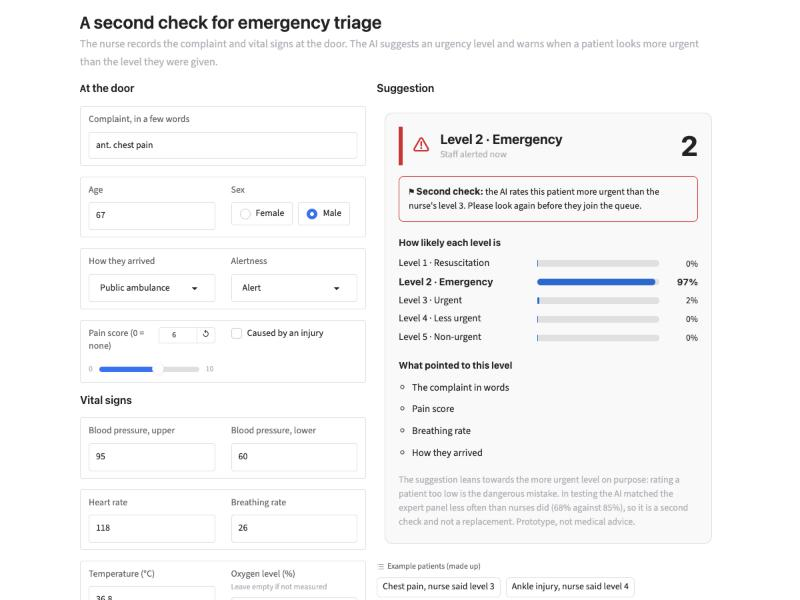
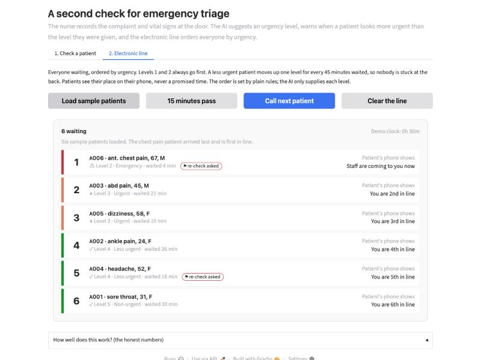
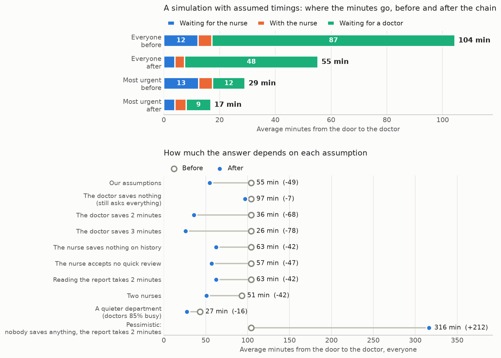

# Triage Queue Assistant: the nurse decides, the app double-checks her and puts the most urgent patients first

**Track:** Health
**Team:** Yegor (backend), Denys (project decisions), Ostap (front end)

*This project is a prototype and is not medical advice.*

> **In one sentence:** our model is worse than nurses at rating emergency patients (68% right against 85%), so the
> nurse always decides and the app never gives a diagnosis. But about 1 patient in 10 is rated too low by the nurse,
> and as a second check our model flags 107 of those 131 patients. Around that check the app runs the visit:
> questions answered on the phone, a report the nurse accepts or checks in person, a line ordered by urgency, and
> the right doctor.
>
> **What we do not claim:** that the department gets faster. Ordering the line by urgency moves waiting time
> rather than removing it. In our simulation the most urgent patients wait 13 minutes instead of 88, everyone else
> waits about 109 instead of 88, and the average stays about the same (88 and 90). Whether the whole chain saves time
> depends on timings nobody has measured; with the ones we assumed it does, and with pessimistic ones it makes
> things worse ([section 5](#5-does-the-whole-chain-save-time-a-simulation-with-assumed-timings)).

**Project guide:** the problem of emergency waiting times, our plan and each person's tasks are in [PROJECT_GUIDE.md](PROJECT_GUIDE.md).

**Project map:** an interactive mind map of the whole project is at https://potlatiy.github.io/emergency-triage-ai/

**Try it online:** [the patient's phone](https://darkshdws-meddy.hf.space) ·
[the nurse's screen](https://darkshdws-meddy.hf.space/nurse) · [the doctor's screen](https://darkshdws-meddy.hf.space/doctor) ·
[the waiting room's board](https://darkshdws-meddy.hf.space/board) · [the chief doctor's panel](https://darkshdws-meddy.hf.space/chief).
**Judges: the staff PINs and a three-minute tour are in [JUDGES.md](JUDGES.md).**
Open the three side by side: check in as a patient, open your code on the nurse's screen and choose a doctor, then
accept yourself on that doctor's screen ("New patient for you: are you free now?"). The phone follows by itself, to
the room and to a thank-you when the doctor finishes. The nurse's and the doctor's screens ask for a staff PIN (see
[JUDGES.md](JUDGES.md); the lock is part of what we built, see the limits). A free server: the first visit after a
quiet day takes about a minute.

## The problem

In a crowded emergency department the queue usually follows arrival order. Imagine ten people waiting. The first
five have a sore arm, leg or knee. The last to arrive has chest pain. Whoever sorts the queue has to notice that
the last person cannot wait, and the nurse doing it is busy.

A triage nurse gives every arriving patient an urgency level from 1 (most urgent) to 5 (least), and the queue
should follow those levels. When a patient is rated too low, someone who needs care now waits behind minor cases.
In the study our data comes from, trained nurses rated about 1 patient in 10 too low.

In the usual flow the wait before triage is short (minutes, up to half an hour). The long wait, which can take hours
for a non-urgent case, comes after triage, when the patient has a level and is waiting for a doctor. Our app works
mostly on that second wait.

## Our idea

Our project helps **the nurse in a busy emergency department** by taking **a patient's complaint and the vital
signs taken at the door** and giving back **a suggested urgency level and a place in a live line**. The AI suggests.
The nurse confirms or changes. Nothing the AI says is final.

How a visit would work, and how much of it we built and tested:

| Step | What happens | Status |
|---|---|---|
| 1. Registration | Before triage, while the patient waits for the nurse (the short queue), they type their insurance card number (or say they have none) and give what is wrong in their own words, age, sex and how they arrived. One person can have one open visit. | Built as a demo step. We built a camera scanner first and removed it: real insurance cards (Medicare, the Spanish SIP card, the German Gesundheitskarte) carry no barcode, so it only read our own sample card. |
| 2. Follow-up questions | The AI chooses three history questions for this complaint (for example when it started, or what was taken for it). The patient taps a quick answer, writes their own, or both, and can describe what happened in their own words. | Built, **not tested**. The answers go to the nurse and the doctor and never change the level. |
| 3. Suggested level | At triage the nurse measures vital signs and enters them. The AI suggests a level from 1 to 5 with the probability of each level. When no level is likely enough, it says it is not sure. | **Built and tested.** |
| 4. Number on the phone | After check-in the phone shows a short code for the nurse. Then it shows the ticket number and place in line, and finally the room to go to: never the level and never a promised time. | Built as a demo. The phone is its own screen and the server never sends it the level. It follows the visit by itself and keeps its place after a reload. |
| 5. Nurse decides | On her own screen the nurse opens the patient by their code, reads what they said and a two-sentence AI summary of it, measures the vital signs, sees the whole line, confirms or changes levels, and a patient the AI rates as more urgent than the nurse did is marked for a second look. In a critical case she sends the patient straight to a doctor herself, skipping the line, and records the reason. | Second-look flag **tested**. The screen is a demo; the AI summary is **not tested** (it is checked in plain code for guesses and diagnoses). Levels 1 and 2 already go straight to the resuscitation team automatically. The reason is written by hand and is required. Meddy suggests a doctor and a short list of three more, each marked free or busy, and the nurse picks one; a busy doctor can still be chosen, and the patient then waits in line for them. |
| 6. Order of the line | Levels 1 and 2 always go first. A less urgent patient moves up one level for every 45 minutes waited, so nobody is stuck at the back. | Plain rules. Ordering effect **simulated**. |
| 7. Doctor gets the note | The nurse chooses the doctor (Meddy suggests the best match and a short list, each marked free or busy, and warns before she sends a patient straight in to a busy one). The chosen doctor's screen asks at once "New patient for you: are you free now?"; "Yes" calls the patient in, "Not now" keeps them under "Waiting for you" with an "Accept" button. The doctor's card opens with a **patient summary** in three parts, each marked with who it comes from: what the patient said (the two AI sentences the nurse read, or plain sentences from the patient's own answers), what the nurse found (her level, the measurements, her note), and what Meddy suggested (its level, how sure it was, its flag). It is written when the nurse sends the patient on (and again if she re-checks them in the waiting room), so the doctor reads what the nurse saw. The full answers and measurements are below it. The patient tells their story once. | Built as a demo: the note is on the doctor's own screen (`/doctor`). The doctor accepts a patient sent to them, or calls the next patient of their department ("Call my next patient"), and closes the visit with "Visit finished"; the patient's phone then says thank you. The department choice is **tested**, the note itself is not. |

The line is ordered by plain rules. The AI only supplies each patient's level.

**Who sees what.** The level from 1 to 5 is shown only to staff, so a patient is not frightened by a number.

| Person | Sees |
|---|---|
| Patient | Ticket number, place in line, what happens next. Never the level, the colours or the AI's probabilities. |
| Nurse | The patient's name, the level, the probability of each level, the second-look flags and the whole line. She decides. |
| Doctor | The patient's name and the note on the patient, including the level. |
| The AI models | The complaint, age, sex, how the patient came, the answers and the vital signs. Never the name or the insurance. |

## What we built

**The demo** (`app.py`). The complaint in a few words and the vital signs go in. A suggested urgency level comes
out, with the probability of each level and the inputs that pointed to it. If the nurse has already given a level
and the AI rates the patient as more urgent, it shows a warning asking her to look again.

**The electronic line.** Each checked patient can be added to a live line ordered by urgency. Flagged patients are
marked for the nurse.

**The digital hospital** (`hospital/`). The whole flow runs as a small hospital with one screen per role: the
patient's phone (`/`, with a marker moving across a floor plan), the nurse's screen (`/nurse`) and the doctor's
screen (`/doctor`). The three follow the same visit through the server, so they can be on three devices or side
by side on one laptop. It runs online on a Hugging Face Space ([deploy/huggingface](deploy/huggingface/README.md)),
which rebuilds itself when `main` changes.

| Stop | What happens | How |
|---|---|---|
| Entrance (phone) | The visit is registered under its own number | Database |
| Check-in (phone) | A quick check for this complaint: three danger signs to tap, what the pain feels like, three optional history questions with quick answers and room to write, and "in your own words". Then the phone shows a code for the nurse | Danger questions come from a hand-written list chosen by the kind of complaint. The three history questions are chosen from six topics and worded on the spot by a small language model running on the same computer; the answers to tap are fixed lists. Check-in never waits for the model |
| Nurse station (nurse's screen) | The nurse's list of patients who finished check-in, danger signs first. She opens one by tapping it, typing the code or scanning the QR code on the phone, and reads what the patient said with a two-sentence summary by the language model. Then Meddy's report: the patient at a glance, a suggested level, and the likely department and doctor. The nurse presses "Everything is correct" or "I want to check the patient myself". In a personal check she gives her own level, sees a "look again" flag when Meddy rates the patient more urgent, and can change the department or send a critical patient straight to a doctor, with a reason. Next to the level Meddy shows a likely range of levels and five real patients from the data who look most like this one | The two models tested in this project. The range and the similar patients are tested in [section 6](#6-a-range-of-levels-and-patients-like-this-one). Meddy says when a quick review is reasonable and when it advises a personal check. Every verdict is counted ("test regime") |
| Waiting room (phone) | Your place in line, updated by itself, and an "I feel worse" button. One press puts the patient on top of the nurse's list for another look; it changes neither the level nor the place in line. The nurse measures again, Meddy writes a new report, and her new decision keeps the ticket and the minutes already waited. The nurse's screen also marks patients who have waited longer than their level allows without a second look | Plain rules: urgency first, then waiting time. A yes to a danger question counts as half a level. Re-check times: level 3 every 30 minutes, 4 every 60, 5 every 120, the reassessment times of the Canadian triage scale that the Korean scale of our data was built from |
| Doctor (doctor's screen, phone) | Department and doctor. The doctor calls the next patient; the phone shows the room | The patient's everyday words are first put in the nurses' words ("my heart hurts" becomes "chest pain"). A model trained on real diagnoses and a key-word rule on the complaint then rate every department together. The database suggests the least busy doctor on duty in the best one, and three more to choose from, each marked free or busy. If nobody is on duty there, general medicine covers. The doctor's note holds the complaint, level, vital signs and check-in answers |

Around the three main screens:

- **The waiting room's board** (`/board`): the tickets called and to which room, how many wait, and the usual wait
  now. No names, complaints or levels, so it can hang on the wall; "Find your ticket" shows where one ticket stands.
  It is our own, unofficial board: in a hospital it would take its calls from, or feed, the hospital's official
  board, and the estimate would sit next to the official display.
- **An estimated wait on the patient's phone**, as a range ("about 15–25 min"), worked out from the load right now:
  the patients ahead for the same doctors are handed out to whichever doctor is free first, each taking that
  doctor's usual visit. The phone says plainly that it is an estimate and not a promise, because a more urgent
  patient goes first.
- **The doctor's note for the patient.** On "Visit finished" the doctor may write a short note; "Tidy with Meddy"
  asks the language model to fix spelling and punctuation only (plain code throws its answer away if it added,
  dropped or changed words or numbers), the doctor chooses, and the patient's phone shows the confirmed note.
- **The chief doctor's panel** (`/chief`, its own PIN): today's patients and where they are, the door-to-doctor wait
  by level, each department's load, and how often the nurses kept Meddy's level.

The internal database is one SQLite file with seven tables: departments, 37 doctors with day and night shifts,
visits, the questionnaire answers, a log of every step of every visit (with its time and who did it), a registry
of people that keeps one open visit per insurance card, and counters. No real patient's visit is ever deleted (finished made-up visits of the simulated hospital are removed after a day,
so the file does not grow for ever): "Start a new day" closes
the open visits and keeps them, and registration numbers are never given twice. Online, a copy of the file is kept
in the Space's storage bucket every few seconds and taken back at start, so a restart or a new version of the code
loses nothing; a newer version adds its tables and columns to the old file instead of wiping it. The rest of the
hospital is simulated while somebody has a screen open: made-up patients from other nurses come to the doctors and
leave a few minutes later, so a doctor the nurse is about to choose may really be busy. The simulation never touches
a real patient, the line, or a doctor whose own screen is open, and "Behind the scenes" can switch it off. The doctors,
their registration numbers and the patients already in the department are made up. Patients give a first and last
name so that staff can call them; the name is shown to the nurse and the doctor only, never sent to either model or
the language model, and never sent back to the patient's phone. In the demonstration everybody uses a made-up name
("Make up a name"). No card number is stored (only a one-way fingerprint).

**Two things have been tested on real data:** the urgency level and the choice of department. The questionnaire, the line and the choice of doctor are demonstrations.

**Meddy never gives a diagnosis.** It suggests an urgency level and a department, and it asks questions. Saying what is wrong with the patient is the doctor's job. Its outputs are limited to the five levels and the nine department names, the patient's screens do not even name the department, and a check in plain code throws away any AI-written question that speaks of a diagnosis or names a condition.

## What we added

Our own idea. Three things go beyond a standard classifier:

- **A human baseline.** We compare the model with real nurses on the same patients, both judged against an
  expert panel.
- **Safety-first decisions.** The model treats rating a patient too low as three times as costly as rating
  them too high.
- **A different job for the AI.** When it turned out the model could not beat nurses, we stopped asking it to
  replace them and tested it as a second check on them instead. The queue simulation also shows what a line sorted
  by the AI's own levels would do.
- **An AI that shows its doubt and its evidence.** Next to its level, Meddy gives a range of levels that held the
  experts' level for 9 unseen patients in 10, and five real patients from the data who look most like this one.
- **A way back to the nurse.** A waiting patient can say "I feel worse", and the nurse's screen marks who is due
  a second look. Urgency is not decided once at the door.

## How it works

**Data.** 1,267 real adult patients from two emergency departments in South Korea (Moon et al., PLOS ONE 2019).
Each has the nurse's level and the correct level decided afterwards by experts. We marked "unmeasurable" vital
signs as missing and kept that fact as an input, set the pain score to 0 for patients without pain, and filled
other gaps with the typical value from the training patients.

**Model.** Logistic regression on what is known at the door: the complaint text (broken into short letter
patterns), age, sex, how the patient arrived, alertness, pain and vital signs. The nurse's level, the diagnosis
and the outcome are never given to the model. We chose a simple model because the data is small and its
weights can be shown to the nurse.

**Testing.** Every patient is scored by a model that never saw them (5-fold cross-validation).

## Results

### 1. Sorting the line (simulated)

The data has no arrival times, so we simulated a busy department with three doctors. Average minutes until a
patient is first seen:

| Queue order | The most urgent patients (levels 1–2) | Everyone else | All patients |
|---|---|---|---|
| First come, first served | 88 | 88 | 88 |
| By the AI's levels | 24 | 107 | 90 |
| By the nurses' levels | 13 | 109 | 90 |
| By the experts' levels | 7 | 107 | 87 |

**Sorting the line does not make the department faster.** It moves waiting time from the most urgent patients to
everyone else: the urgent gain about 75 minutes, the others lose about 20, and the average barely changes. That
trade is the point of triage, and real departments already make it with the nurses' levels.

Ordering by urgency matters more than who does it. In our design the nurse sets the level, so the row to read is
"By the nurses' levels" (88 down to 13 minutes). The AI row shows what a line sorted by the AI's own levels would do,
which we do not propose because the AI is worse than a nurse at the level. The experts' row is the best possible case.
The second check exists to move the nurses' levels closer to it. We did not simulate the second check itself.

### 2. How good is the level itself

| | Exact level | Rated too low (dangerous) | Rated too high |
|---|---|---|---|
| Baseline: always level 3 | 38% | 19% | 42% |
| AI, most likely level | 68% | 16% | 16% |
| AI, safety-first | 60% | 8% | 32% |
| Nurses | 85% | 10% | 4% |

**The model cannot replace a triage nurse.** It beats the baseline easily and loses clearly to nurses. This is
why the nurse stays the decision-maker in our design.

### 3. As a second check

When the nurse has already given a level, the AI flags 107 of the 131 patients that nurses rated too low (82%,
with a 95% range of 75–88%). The price is a re-check on 36% of all patients, most of whom were rated correctly.

A stricter flag gives fewer false alarms: raised only when the model thinks it more likely than not that the right
level is more urgent than the nurse's, it fires for 21% of patients and still reaches 91 of the 131 (69%, range
62–77%). About 1 of these flags in 3 is right, against 1 in 4 before. The digital hospital shows this one as the
flag and the rest as a milder note.

### 3b. When can the nurse accept the AI's report after a quick look?

In the digital hospital the nurse reviews Meddy's report and either accepts it or checks the patient herself.
Accepting is only reasonable where the AI's level holds up, so we tested one plain rule: the model is at least 80%
sure, it suggests level 3 to 5, and the patient shows no warning sign.

| | Patients | AI level right | AI too low | Nurses right | Nurses too low |
|---|---|---|---|---|---|
| Quick review offered | 325 (26%) | 84% | 7% | 89% | 7% |
| Personal check advised | 942 (74%) | 63% | 19% | 84% | 11% |

Where a quick review is offered, the AI's level is too low about as rarely as the nurses' own (7% and 7% here), though
it is still right less often. We chose the 80% cut-off on these same patients, so that tie should not be trusted to the
point: the AI's 7% has a 95% range of 4–10%, and with ten other random splits of the data it averages 7.9% against 6.8%
for the nurses. "About as good, or slightly worse" is the fair reading. Everywhere else the AI is clearly worse than a
nurse, so the app advises a personal check. One more case exists in the app: when Meddy suggests level 1 or 2, accepting
the report sends the patient to the resuscitation team at once, which is the safe direction, so that is offered too. Of the 246
patients experts rated level 1 or 2, 10 would be offered a quick review, so the nurse's review is a real step.
The hospital adds two conditions the data cannot test: no danger sign answered yes, and a complaint Meddy can read.
"No warning sign" means none among what was measured: 195 of the 325 patients had no oxygen measurement at all,
because one of the two hospitals never recorded it. In the app an unmeasured vital sign counts as a warning.

It beats simple rules, not just chance. If nurses can re-check only a share of patients, this is the share of
under-rated patients they reach (95% range in brackets):

| Who picks the patients to re-check | Re-check 10% | Re-check 20% | Re-check 30% |
|---|---|---|---|
| Random choice | 10% | 20% | 30% |
| Rule: most abnormal vital signs first | 20% (15–25%) | 34% (28–41%) | 43% (37–49%) |
| Rule: patients the nurse rated lowest first | 23% (17–28%) | 36% (31–41%) | 49% (44–55%) |
| **Our model** | **37% (30–45%)** | **67% (60–75%)** | **77% (70–83%)** |

The two rules give many patients the same score, so the cut-off falls inside a group of equals; we count that group
by its share. (An earlier version of this table broke such ties with one random draw, which put the second rule at
55% for a 30% budget when its average is 49%.)

We also built a second model specially for this job, which sees the nurse's level and predicts "rated too low".
It did not do better (63% at a 20% budget), so we kept the simpler model.

### 4. Sending the patient to the right department

The answer key is the department of each patient's real final diagnosis. We matched all 584 distinct diagnoses to
one of nine departments ourselves (`data/diagnosis_departments.csv`, reproduce with `python assignment.py`).

| Method | Picks the right department |
|---|---|
| Baseline: always gastroenterology and surgery | 21% |
| Key-word rule on the complaint | 67% |
| Trained model | 70% |
| What the digital hospital uses: the model and the key-word rule together | 69% |

The model's lead over the rule is 3.7 points (95% range 1.4 to 6.1). It is weaker than the rule for respiratory,
gynaecology and general medicine patients. The right department is among its top three suggestions 88% of the time. The digital hospital averages the model's
estimate with the key-word rule, because patients do not write like nurses: alone, the model read "heart pain" as
neurology. On the nurses' own complaints the combination is as good as before (69%), and the right department is
among the four it offers the nurse 92% of the time. Before either reads a complaint, everyday words are put in the
nurses' words, which on 34 everyday complaints raised the urgency model's average confidence from 55% to 66%.

### 5. Does the whole chain save time? (a simulation with assumed timings)

The line simulation above only changes the order of the line. It moves waiting time from the most urgent patients
to everyone else and does not shorten the average wait: in that simulation the average is 88 minutes in arrival
order and 90 when the line is sorted by urgency. So we simulated the whole chain, before and after, with a
nurse station in front of the doctors (`python chain_time.py`).

**Every timing in it is our assumption**, because the data has no times at all: 5 minutes for a full assessment
by the nurse, 20 for a consultation, 1.5 minutes saved for the nurse and 1 for the doctor because the patient
answered the history questions on the phone, half a minute for the nurse to read Meddy's report, 1.5 minutes
for a quick review, and 1 minute for a re-check when the strong flag is raised. We also assume that the nurse
accepts every quick review she is offered and corrects half of the under-rated patients she re-checks. What is real: the patients, their levels, and which of them would be offered a quick review
or flagged.

| Average minutes from the door to the doctor | Everyone | Most urgent |
|---|---|---|
| Before | 104 | 29 |
| After, with our assumed timings | 55 | 17 |
| After, if the doctor saves nothing | 97 | 21 |
| After, if the doctor saves 2 minutes | 36 | 15 |
| After, if nobody saves anything and the report takes the nurse 2 minutes | 316 | 269 |

What we take from it:

- **It does not prove that the app saves time.** With our timings the average falls from 104 to 55 minutes, but
  most of that comes from one assumption: that the doctor saves a single minute per patient. Without it the
  saving is 7 minutes.
- **A busy department is very sensitive to small savings.** When doctors are occupied 95% of the time, one minute
  less per patient nearly halves the wait for a doctor. That is true of any such department, not of our app.
- **It cuts both ways.** If the report only costs the nurse time and saves nobody anything, the single nurse
  becomes the bottleneck and the department gets far slower.
- **Speeding up the nurse alone does little** while the doctors are the bottleneck: patients just wait in the
  next line.
- **What has to be measured** before anyone can claim a saving: the minutes a doctor saves by having the answers
  already, and the minutes a nurse spends on a report compared with a full assessment.

### 6. A range of levels, and patients like this one

**A range with a promise.** One level is right for 68% of patients, so Meddy also gives a range, such as "level 3
to level 4". A level is in the range when its probability reaches a cut. The cut is set so that the experts' level
stays in for 90% of patients (conformal prediction; nothing is tuned by hand). We found the cut on one random half
of the patients and tried it on the other half, 500 times.

| | Experts' level inside | Levels wide | Urgent patients (1–2) inside |
|---|---|---|---|
| Range, promise 90% (used) | 90.6% (87% to 93% over the 500 tries) | 2.0 | 80% |
| Range, promise 95% | 95.4% | 2.5 | 89% |
| Baseline: the most likely level and one level either side | 95.7% | 2.9 | 92% |
| The single most likely level | 68% | 1 | |

On patients from these two hospitals the promise is kept, and at the same coverage our range is narrower than the
baseline (2.5 levels against 2.9). With the 90% range the patient was more urgent than the range for 4.7% of
patients and less urgent for 4.8%. The range is a single level for 27% of patients, and a narrow range is right
less often: the experts' level was inside 82% of one-level ranges, 93% of two-level ranges and 96% of wider ones.
The nurse's screen shows the figure for the width in front of her.

**The weak results.**

- **The promise is an average.** Only 8 in 10 of the most urgent patients are inside the 90% range (level 1: 78%,
  level 2: 80%, level 5: 58%), and for them the simple baseline is better.
- **For urgent patients a miss is nearly always the dangerous way.** 19% of the level 1 and 2 patients got a range
  that was entirely less urgent than they were. The screens were shortened and no longer carry this warning:
  the nurse sees how often a range that wide was right, the doctor sees the range alone.
- **It does not travel.** With the model and the cut from one hospital tried at the other, the experts' level was
  inside for 87% of patients and for 64% of the urgent ones. The promise is for patients like those in the data.

**Patients like this one.** Meddy shows the nurse five real patients from the data who look most like the patient
in front of her, with the level their nurse gave and the level the experts gave. The diagnosis is never used.
"Alike" mixes the complaint words (40%), the numbers (40%) and the tick-box answers (20%); patients with the same
kind of complaint, read by the key-word rule, come first. Each patient was looked up among patients of the other
four test folds.

| | Their most common level was the experts' level | At least one of them had it |
|---|---|---|
| Same kind first, then the mix (used) | 61% | 89% |
| The mix without the kind | 60% | 89% |
| Complaint words only | 52% | 89% |
| Numbers only | 47% | 86% |
| Baseline: five patients picked at random | 33% | 79% |
| For comparison: always the most common level 38%, the urgency model 68% | | |

The most common level can win with two of the five; three or more of the five had the experts' level for 57% of
patients. "At least one of them had it" says little: five random patients manage 79%, and the model's own two
most likely levels 89%. The similar patients are weaker than the model, so they are shown as evidence to look at,
not as a second opinion.

### Where it fails

- **The range misses one urgent patient in five, nearly always on the dangerous side, and it does not travel**
  to another hospital. See section 6: the 90% promise holds on average for patients like those in the data.
- **Urgent patients sent to the slow queue.** With the safety-first setting the model gave level 4 or 5 to seven
  patients whom experts rated level 1 or 2. They include a chest pain complaint written in Korean with no vital
  signs, two poisonings and an eye injury, where the danger does not show in the measurements. Nurses rated five of
  the seven correctly. With the most likely level, which is what Meddy shows as its suggestion, it is 19 patients,
  and nurses rated 14 of them correctly. This is why the nurse decides.
- **It does not travel.** Trained at one hospital and tested at the other, the exact level drops from 68% to
  55–58%, and in one direction 49 urgent patients ended up in the slow queue.
- **Groups.** With the safety-first setting, 9% of women and 7% of men are rated too low (nurses: 12% and 9%).

### Limits

- One country, 1,267 patients and only 26 at level 1.
- **The data is not from patients typing for themselves.** The complaints in our data were written by nurses in
  short phrases. A patient entering their own words on a phone will write differently, and we did not test that.
- Hiding the level from patients is our design choice to avoid panic. We did not test how patients react.
- **The nurse reviewing a report is not the same as the nurse deciding alone.** Our second-check result (107 of 131) was measured with the nurse giving her level first. When she reads Meddy's report before deciding, she may agree with it more often than she should. We count every verdict in the app ("test regime"), but we have not tried it with real nurses.
- **Five patients appear twice in the data** (the same visit with two diagnoses), so the 1,267 rows are 1,262 visits, and such a pair can sit on both sides of a test split. Removing them changes nothing that matters: the exact level goes from 68.1% to 68.6%, and the second check from 107 of 131 to 107 of 130. The range of levels and the similar-patients figures do not change either.
- **The department model's version was chosen on the same test splits it is reported on.** We tried four versions and kept the best, so its 70% and its 3.7-point lead over the key-word rule may be up to a point too kind. It still beats the rule.
- **One diagnosis cannot be sorted by its name.** "Percutaneous catheter problem" (8 patients) covers urinary catheters and feeding or bile tubes. Our table sends all 8 to urology, and about half belong to gastroenterology.
- **Each queue order was simulated on its own 200 random days**, so a difference of a minute or two between two rows of the first table is luck. The large differences are not.
- **The way of finding similar patients was chosen on the same test splits it is reported on.** We tried four and kept the best, so its 61% is a little flattering; the kind-first step adds one point, which could be chance. A complaint the key-word rule does not recognise (1 in 5 in the data) finds patients who are alike mostly in age and measurements; the screen marks them.
- **"I feel worse" and the re-check times are not tested.** Our data has one measurement per patient, so we cannot measure how often a second look changes the level. The re-check times are those of the Canadian scale; we did not find a published table for the Korean one. A patient can press the button without feeling worse: in the waiting room it only calls the nurse and never moves them up the line. A patient who is still waiting for the nurse's first look goes to the top of her list, ahead of danger signs. Like every screen in the demonstration it has no sign-in, so anyone who knows a registration number could press for that patient. While the nurse is re-checking a patient no doctor can call them, for 15 minutes at most; that number is our choice.
- **The staff PIN is a lock on the door, not a sign-in.** One PIN is shared by all staff. It keeps a passer-by out of the patients' names and away from "Start a new day"; it does not say who did what. A real department would give every nurse and doctor their own account. A patient without insurance can still register more than once: there is nothing to recognise them by.
- **The estimated wait, the board and the chief doctor's panel are not tested against a real department.** The estimate
  uses the doctors' visit times in the demo, most of them from the simulated patients; with real patients it should be
  checked against the waits that follow. The board is our own and not connected to any hospital's system.
- **Waiting time is real time.** The clock moves by itself, so "waited 30 min" means 30 minutes; "15 minutes pass" on the nurse's screen jumps it ahead for a demonstration.
- **The follow-up questions are not tested.** We have no data on whether they make the level better.
- **We ask what the pain feels like, not how bad it is.** The model was trained with the 0 to 10 pain score nurses recorded. A patient with pain gets 4, the typical score of the patients who had pain in our data, and a patient without pain gets 0. We did not test what this loses.
- **Insurance is only an identity check.** A card can have one open visit at a time. The registry keeps a one-way fingerprint of the card number and its last four characters, never the number itself, and insurance is never given to either model. A patient without insurance is always registered. The card scanner reads a barcode or QR code in Chrome; we tested it on our own sample card, not on real insurance cards or with a real camera in a department.
- **Patients may exaggerate or play things down.** Someone who writes "I am dying" about a sore finger can jump the line, and someone who plays down chest pain can be missed. The model cannot tell. We reduce the risk in three ways: vital signs are measured and not self-reported, the nurse sees every answer and decides, and check-in asks about facts to tap (danger signs, what the pain feels like, when it started), not for a judgement of how serious it is. We did not test how well this works. The half-level boost for a "yes" to a danger question could be gamed.
- **Who measures the vital signs is not solved.** In the demo the nurse types them in. In a real department it could be a self-service blood pressure cuff and finger pulse meter, or an assistant at the door, with people who answered "yes" to a danger question measured first. None of this is built or tested.
- The waiting times are a simulation with invented arrivals.
- The department answer key is our own diagnosis-to-department table. 83 rarer diagnoses matched no rule and default to general medicine. We read every row and corrected 14 by hand, but no clinician has reviewed it.
- The three-to-one safety weighting and the 45-minute rule are our choices.
- We did not test whether real nurses would act on the flags or the suggested order.
- The QR registration, phone screen and digital hospital are demonstrations, not tried in a real department.

## What we'd do next

1. Try the suggested order and the flags with real triage nurses and measure how many re-checks change the level.
2. Collect complaints written by patients themselves and test whether the follow-up questions improve the level.
3. Train and test on more hospitals, since the model got worse when moved between two.

## Run it

- **Notebook:** open `triage.ipynb`. All outputs are saved in it.
- **Trained models:** both are saved in [`models/`](models/README.md), so nothing needs training. `python trained_models.py` makes them again.
- **Demo:** `pip install -r requirements.txt`, then `python app.py` and open http://localhost:7861.
- **Online:** https://darkshdws-meddy.hf.space (nurse: `/nurse`, doctor: `/doctor`). See [deploy/huggingface](deploy/huggingface/README.md).
- **Staff PIN:** when the server is started with `MEDDY_STAFF_PIN` set, the nurse's and the doctor's screens and
  every staff action (also "Start a new day" and "15 minutes pass") ask for that PIN. The patient's phone never
  needs it and can only ask about its own visit. Without the setting, as on a laptop, the screens are open.
- **Digital hospital:** `python hospital/server.py` and open http://localhost:8000 (the patient's phone),
  http://localhost:8000/nurse and http://localhost:8000/doctor. For AI-written questions and the nurse's summary,
  install Ollama and run `ollama pull gemma3:4b` first (the online copy uses `gemma3:1b`: set `MEDDY_OLLAMA_MODEL`);
  without it the hand-written questions are used, the nurse sees no AI summary, and the doctor's patient summary is
  written by a template from the patient's own answers.
- **Check in from a phone:** start it with `MEDDY_LAN=1 python hospital/server.py`. The entrance step then shows a
  QR code that phones on the same Wi-Fi can scan. Without `MEDDY_LAN=1` the server only answers this computer.

## Sources

- **Dataset:** Moon S-H, Shim JL, Park K-S, Park C-S (2019). Triage accuracy and causes of mistriage using the
  Korean Triage and Acuity Scale. PLOS ONE 14(9): e0216972. https://doi.org/10.1371/journal.pone.0216972
  (supporting files S1 and S2, CC BY 4.0, unchanged apart from file names and CSV copies).
- **The range of levels (conformal prediction):** Angelopoulos AN, Bates S (2021). A Gentle Introduction to
  Conformal Prediction and Distribution-Free Uncertainty Quantification. https://arxiv.org/abs/2107.07511
- **Re-check times while waiting:** the reassessment times of the Canadian Triage and Acuity Scale (level 2 every
  15 minutes, 3 every 30, 4 every 60, 5 every 120). Murray M, Bullard M, Grafstein E (2004). Revisions to the
  Canadian Emergency Department Triage and Acuity Scale implementation guidelines. CJEM 6(6): 421–427. We read the
  times in training material and a hospital policy that quote the guideline, not in the guideline itself.
- **Libraries:** pandas (https://pandas.pydata.org), scikit-learn (https://scikit-learn.org),
  Matplotlib (https://matplotlib.org), Gradio (https://gradio.app)
- **Language model for the check-in questions:** Gemma 3 (4B) by Google, run locally through Ollama (https://ollama.com/library/gemma3)
- **Web server:** FastAPI (https://fastapi.tiangolo.com)
- **AI tools:** Claude (Claude Code, https://claude.com/claude-code) was used to help write and explain the
  code and to draft this write-up.
