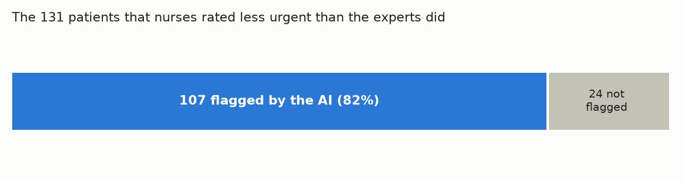
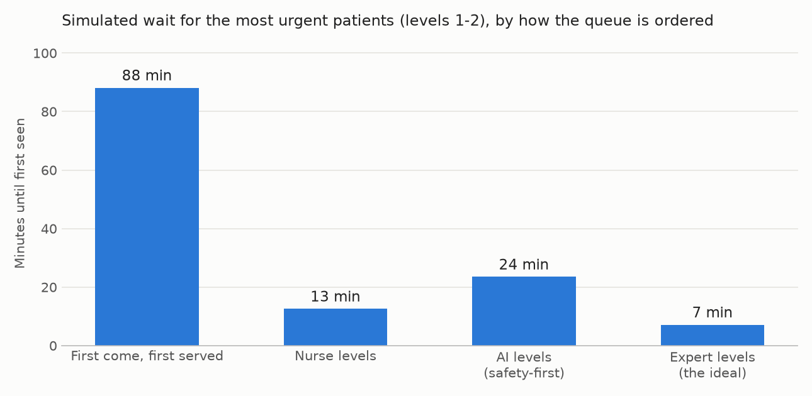

# Can AI be a second check on emergency triage?

**Track:** Health
**Team:** Yegor (backend), Denys (project decisions), Ostap (front end)

*This project is a prototype and is not medical advice.*

> **In one sentence:** our model is worse than nurses at giving emergency patients an urgency level
> (68% right against 85%), but used as a second check it flags 107 of the 131 patients that nurses rated
> less urgent than they really were.

**Project map:** an interactive mind map of the whole project is at https://potlatiy.github.io/emergency-triage-ai/

**Website:** the public website is called **Meddy** ("Your triage buddy"). Its plan and design prompt are in [design/](design/README.md).

## The problem

In an emergency department a triage nurse gives every arriving patient an urgency level from 1 (most urgent)
to 5 (least), and the queue follows those levels. When a patient is rated too low, someone who needs care now
waits behind minor cases. In the study our data comes from, trained nurses rated about 1 patient in 10 too low.

## What we built

A second check for the triage nurse. The complaint in a few words and the vital signs taken at the door go in.
A suggested urgency level comes out, with the probability of each level and the inputs that pointed to it.
If the nurse has already given a level and the AI rates the patient as more urgent, it shows a warning asking
her to look again. When no level is likely enough, it says it is not sure.

**The electronic line.** Each checked patient can be added to a live line ordered by urgency. Levels 1 and 2
always go first. A less urgent patient moves up one level for every 45 minutes waited, so nobody is stuck at the
back. Flagged patients are marked for the nurse, and each patient's phone shows their place in line, never a
promised time. The line is ordered by plain rules; the AI only supplies each patient's level.

**The digital hospital.** For the presentation, the whole flow runs as a small hospital you walk through as
the patient. You say what is wrong at the entrance and your visit gets a registration number. At check-in you
answer a questionnaire built for your complaint. The nurse station takes your vital signs and suggests a level.
You sit in the waiting room, and are then called to a doctor who is on duty. A marker moves across the floor plan
as you go, and a panel shows the hospital's database changing underneath.

What each stop uses:

| Stop | What happens | How |
|---|---|---|
| Entrance | The visit is registered under its own number | Database |
| Check-in | A questionnaire for this complaint: three danger-sign questions and two follow-up questions | Danger questions come from a hand-written list chosen by the kind of complaint. The two follow-ups are written on the spot by a small language model running on the same computer |
| Nurse station | Suggested urgency level | The model tested in this project |
| Waiting room | Your place in line | Plain rules: urgency first, then waiting time. A yes to a danger question counts as half a level |
| Doctor | Department and doctor | Plain rules: key words in the complaint pick the department, then the database picks the least busy doctor who is on duty. If nobody is on duty there, general medicine covers |

**The internal database** is one SQLite file with three tables: doctors (registration number, department, room,
on duty or not, patients waiting), visits (registration number, ticket, complaint, level, status, assigned doctor)
and the questionnaire answers. In the demo you can switch a doctor off duty and watch the next patient be matched
around them.

Only the urgency level has been tested. The questionnaire, the line and the doctor match are demonstrations.
Answers to the AI-written questions are passed to the doctor but never change the level, because nobody has
checked those questions. The doctors and their registration numbers are made up. No patient names are asked for,
and the database is wiped each time the server starts.

## What we added

Our own idea. Three things go beyond a standard classifier:

- **A human baseline.** We compare the model with real nurses on the same patients, both judged against an
  expert panel.
- **Safety-first decisions.** The model treats rating a patient too low as three times as costly as rating
  them too high.
- **A different job for the AI.** When it turned out the model could not beat nurses, we tested it as a
  second check on them instead.

## How it works

**Data.** 1,267 real adult patients from two emergency departments in South Korea (Moon et al., PLOS ONE 2019).
Each has the nurse's level and the correct level decided afterwards by experts. We marked "unmeasurable" vital
signs as missing and kept that fact as an input, set the pain score to 0 for patients without pain, and filled
other gaps with the typical value from the training patients.

**Model.** Logistic regression on what is known at the door: the complaint text (broken into short letter
patterns), age, sex, how the patient arrived, alertness, pain and vital signs. The nurse's level, the diagnosis
and the outcome are never given to the model. We chose a simple model because the data is small and its
weights can be shown to the nurse.

**Testing.** Every patient is scored by a model that never saw them (5-fold cross-validation).

## Results

| | Exact level | Rated too low (dangerous) | Rated too high |
|---|---|---|---|
| Baseline: always level 3 | 38% | 19% | 42% |
| AI, most likely level | 68% | 16% | 16% |
| AI, safety-first | 60% | 8% | 32% |
| Nurses | 85% | 10% | 4% |

**The model cannot replace a triage nurse.** It beats the baseline easily and loses clearly to nurses.

**As a second check it is useful.** It flags 107 of the 131 patients that nurses rated too low (82%, with a
95% range of 75–88%). The price is a re-check on 36% of all patients, most of whom were rated correctly.

**It beats simple rules, not just chance.** If nurses can re-check only a share of patients, this is the share of
under-rated patients they reach (95% range in brackets):

| Who picks the patients to re-check | Re-check 10% | Re-check 20% | Re-check 30% |
|---|---|---|---|
| Random choice | 10% | 20% | 30% |
| Rule: most abnormal vital signs first | 18% (14–26%) | 34% (27–42%) | 41% (35–50%) |
| Rule: patients the nurse rated lowest first | 23% (16–29%) | 38% (28–43%) | 55% (42–57%) |
| **Our model** | **37% (30–45%)** | **67% (60–75%)** | **77% (70–83%)** |

We also built a second model specially for this job, which sees the nurse's level and predicts "rated too low".
It did not do better (63% at a 20% budget), so we kept the simpler model.

**Waiting time (simulated).** The data has no arrival times, so we simulated a busy department with three
doctors. The most urgent patients waited 88 minutes under first come, first served, 24 minutes with the AI's
levels, 13 with the nurses' levels and 7 with the experts'. Ordering by urgency matters more than who does it.

**Where it fails.**

- **Seven urgent patients sent to the slow queue.** They include a chest pain complaint written in Korean with
  no vital signs, two poisonings and an eye injury, where the danger does not show in the measurements.
  Nurses rated five of the seven correctly.
- **It does not travel.** Trained at one hospital and tested at the other, the exact level drops from 68% to
  55–58%, and in one direction 49 urgent patients ended up in the slow queue.
- **Groups.** With the safety-first setting, 9% of women and 7% of men are rated too low (nurses: 12% and 9%).

**Limits.** One country, 1,267 patients and only 26 at level 1. The waiting times are a simulation with
invented arrivals. The three-to-one safety weighting is our choice. We did not test whether real nurses would
act on the flags. The electronic line is a demonstration: its 45-minute rule is our choice and it was not tried
in a real department.

## What we'd do next

1. Try the flags with real triage nurses and measure how many re-checks change the level.
2. Train and test on more hospitals, since the model got worse when moved between two.

## Run it

- **Notebook:** open `triage.ipynb`. All outputs are saved in it.
- **Demo:** `pip install -r requirements.txt`, then `python app.py` and open http://localhost:7861.
- **Digital hospital:** `python hospital/server.py` and open http://localhost:8000. For AI-written questions,
  install Ollama and run `ollama pull gemma3:4b` first; without it the hand-written questions are used.

## Sources

- **Dataset:** Moon S-H, Shim JL, Park K-S, Park C-S (2019). Triage accuracy and causes of mistriage using the
  Korean Triage and Acuity Scale. PLOS ONE 14(9): e0216972. https://doi.org/10.1371/journal.pone.0216972
  (supporting files S1 and S2, CC BY 4.0, unchanged apart from file names and CSV copies).
- **Libraries:** pandas (https://pandas.pydata.org), scikit-learn (https://scikit-learn.org),
  Matplotlib (https://matplotlib.org), Gradio (https://gradio.app)
- **Language model for the check-in questions:** Gemma 3 (4B) by Google, run locally through Ollama (https://ollama.com/library/gemma3)
- **Web server:** FastAPI (https://fastapi.tiangolo.com)
- **AI tools:** Claude (Claude Code, https://claude.com/claude-code) was used to help write and explain the
  code and to draft this write-up.
