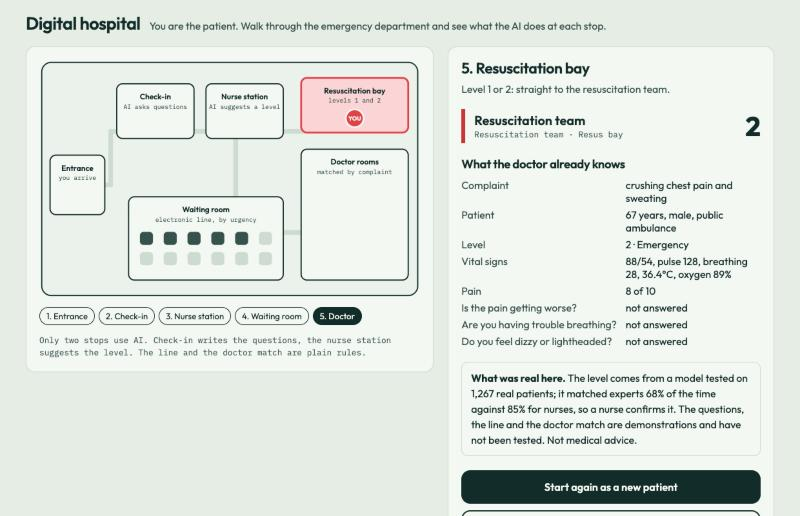

# Triage Queue Assistant: the nurse decides, the app shortens the wait after triage

**Track:** Health
**Team:** Yegor (backend), Denys (project decisions), Ostap (front end)

*This project is a prototype and is not medical advice.*

> **In one sentence:** our model is worse than nurses at rating emergency patients (68% right against 85%), so the
> nurse always decides. But the nurse's level decides who waits for hours after triage, and about 1 patient in 10 is
> rated too low. As a second check our model flags 107 of the 131 patients that nurses rated too low. Around it the
> app handles the long wait: a line ordered by urgency (88 down to 13 minutes for the most urgent patients in our
> simulation), the right doctor, and a note so the patient tells their story once.

**Project guide:** the problem of emergency waiting times, our plan and each person's tasks are in [PROJECT_GUIDE.md](PROJECT_GUIDE.md).

**Project map:** an interactive mind map of the whole project is at https://potlatiy.github.io/emergency-triage-ai/

## The problem

In a crowded emergency department the queue usually follows arrival order. Imagine ten people waiting. The first
five have a sore arm, leg or knee. The last to arrive has chest pain. Whoever sorts the queue has to notice that
the last person cannot wait, and the nurse doing it is busy.

A triage nurse gives every arriving patient an urgency level from 1 (most urgent) to 5 (least), and the queue
should follow those levels. When a patient is rated too low, someone who needs care now waits behind minor cases.
In the study our data comes from, trained nurses rated about 1 patient in 10 too low.

In the usual flow the wait before triage is short (minutes, up to half an hour). The long wait, which can take hours
for a non-urgent case, comes after triage, when the patient has a level and is waiting for a doctor. Our app works
mostly on that second wait.

## Our idea

Our project helps **the nurse in a busy emergency department** by taking **a patient's complaint and the vital
signs taken at the door** and giving back **a suggested urgency level and a place in a live line**. The AI suggests.
The nurse confirms or changes. Nothing the AI says is final.

How a visit would work, and how much of it we built and tested:

| Step | What happens | Status |
|---|---|---|
| 1. Registration | Before triage, while the patient waits for the nurse (the short queue), they scan a QR code (or a nurse helps) and give age, what hurts, why, and what could have caused it. | Built as a demo step. There is no real QR scanner. |
| 2. Follow-up questions | The AI asks one or two questions about this complaint. | Built, **not tested**. The answers go to the doctor and never change the level. |
| 3. Suggested level | At triage the nurse measures vital signs and enters them. The AI suggests a level from 1 to 5 with the probability of each level. When no level is likely enough, it says it is not sure. | **Built and tested.** |
| 4. Number on the phone | The patient sees their ticket number and place in line, never their level and never a promised time. | Designed so. In the demo all views share one screen, so the level is still visible there. |
| 5. Nurse decides | The nurse sees the whole line, confirms or changes levels, and a patient the AI rates as more urgent than the nurse did is marked for a second look. In a critical case she sends the patient straight to a doctor herself, skipping the line, and records the reason. | Second-look flag **tested**. The screen is a demo. Levels 1 and 2 already go straight to the resuscitation team automatically. Choosing the doctor and writing the reason by hand is **not built yet**. |
| 6. Order of the line | Levels 1 and 2 always go first. A less urgent patient moves up one level for every 45 minutes waited, so nobody is stuck at the back. | Plain rules. Ordering effect **simulated**. |
| 7. Doctor gets the note | When the patient is called, the system matches them to a department and to the least busy doctor on duty, and prepares a note for that doctor: complaint, age and sex, urgency level (and whether the AI was not sure), vital signs, pain, and the answers from check-in. The patient tells their story once. | Built as a demo: the note appears on screen, there is no separate doctor screen yet. The department choice is **tested**, the note itself is not. |

The line is ordered by plain rules. The AI only supplies each patient's level.

**Who sees what.** The level from 1 to 5 is shown only to staff, so a patient is not frightened by a number.

| Person | Sees |
|---|---|
| Patient | Ticket number, place in line, what happens next. Never the level, the colours or the AI's probabilities. |
| Nurse | The level, the probability of each level, the second-look flags and the whole line. She decides. |
| Doctor | The note on the patient, including the level. |

## What we built

**The demo** (`app.py`). The complaint in a few words and the vital signs go in. A suggested urgency level comes
out, with the probability of each level and the inputs that pointed to it. If the nurse has already given a level
and the AI rates the patient as more urgent, it shows a warning asking her to look again.

**The electronic line.** Each checked patient can be added to a live line ordered by urgency. Flagged patients are
marked for the nurse.

**The digital hospital** (`hospital/`). For the presentation, the whole flow runs as a small hospital you walk
through as the patient, with a marker moving across a floor plan and a panel showing the database changing
underneath.

| Stop | What happens | How |
|---|---|---|
| Entrance | The visit is registered under its own number | Database |
| Check-in | A questionnaire for this complaint: three danger-sign questions and two follow-up questions | Danger questions come from a hand-written list chosen by the kind of complaint. The two follow-ups are written on the spot by a small language model running on the same computer |
| Nurse station | Suggested urgency level | The model tested in this project |
| Waiting room | Your place in line | Plain rules: urgency first, then waiting time. A yes to a danger question counts as half a level |
| Doctor | Department and doctor | A model trained on real diagnoses picks the department when it is at least 70% sure. Otherwise a key-word rule on the complaint decides. Then the database picks the least busy doctor who is on duty. If nobody is on duty there, general medicine covers. The doctor's note holds the complaint, level, vital signs and check-in answers |

The internal database is one SQLite file with three tables: doctors, visits and the questionnaire answers. The
doctors and their registration numbers are made up. No patient names are asked for, and the database is wiped each
time the server starts.

**Two things have been tested on real data:** the urgency level and the choice of department. The questionnaire, the line and the choice of doctor are demonstrations.

## What we added

Our own idea. Three things go beyond a standard classifier:

- **A human baseline.** We compare the model with real nurses on the same patients, both judged against an
  expert panel.
- **Safety-first decisions.** The model treats rating a patient too low as three times as costly as rating
  them too high.
- **A different job for the AI.** When it turned out the model could not beat nurses, we stopped asking it to
  replace them and tested it as a second check on them instead. The queue simulation also shows what a line sorted
  by the AI's own levels would do.

## How it works

**Data.** 1,267 real adult patients from two emergency departments in South Korea (Moon et al., PLOS ONE 2019).
Each has the nurse's level and the correct level decided afterwards by experts. We marked "unmeasurable" vital
signs as missing and kept that fact as an input, set the pain score to 0 for patients without pain, and filled
other gaps with the typical value from the training patients.

**Model.** Logistic regression on what is known at the door: the complaint text (broken into short letter
patterns), age, sex, how the patient arrived, alertness, pain and vital signs. The nurse's level, the diagnosis
and the outcome are never given to the model. We chose a simple model because the data is small and its
weights can be shown to the nurse.

**Testing.** Every patient is scored by a model that never saw them (5-fold cross-validation).

## Results

### 1. Sorting the line (simulated)

The data has no arrival times, so we simulated a busy department with three doctors. The most urgent patients
waited this long to be seen:

| Queue order | Wait for the most urgent patients |
|---|---|
| First come, first served | 88 minutes |
| By the AI's levels | 24 minutes |
| By the nurses' levels | 13 minutes |
| By the experts' levels | 7 minutes |

Ordering by urgency matters more than who does it. In our design the nurse sets the level, so the row to read is
"By the nurses' levels" (88 down to 13 minutes). The AI row shows what a line sorted by the AI's own levels would do,
which we do not propose because the AI is worse than a nurse at the level. The experts' row is the best possible case.
The second check exists to move the nurses' levels closer to it. We did not simulate the second check itself.

### 2. How good is the level itself

| | Exact level | Rated too low (dangerous) | Rated too high |
|---|---|---|---|
| Baseline: always level 3 | 38% | 19% | 42% |
| AI, most likely level | 68% | 16% | 16% |
| AI, safety-first | 60% | 8% | 32% |
| Nurses | 85% | 10% | 4% |

**The model cannot replace a triage nurse.** It beats the baseline easily and loses clearly to nurses. This is
why the nurse stays the decision-maker in our design.

### 3. As a second check

When the nurse has already given a level, the AI flags 107 of the 131 patients that nurses rated too low (82%,
with a 95% range of 75–88%). The price is a re-check on 36% of all patients, most of whom were rated correctly.

It beats simple rules, not just chance. If nurses can re-check only a share of patients, this is the share of
under-rated patients they reach (95% range in brackets):

| Who picks the patients to re-check | Re-check 10% | Re-check 20% | Re-check 30% |
|---|---|---|---|
| Random choice | 10% | 20% | 30% |
| Rule: most abnormal vital signs first | 18% (14–26%) | 34% (27–42%) | 41% (35–50%) |
| Rule: patients the nurse rated lowest first | 23% (16–29%) | 38% (28–43%) | 55% (42–57%) |
| **Our model** | **37% (30–45%)** | **67% (60–75%)** | **77% (70–83%)** |

We also built a second model specially for this job, which sees the nurse's level and predicts "rated too low".
It did not do better (63% at a 20% budget), so we kept the simpler model.

### 4. Sending the patient to the right department

The answer key is the department of each patient's real final diagnosis. We matched all 584 distinct diagnoses to
one of nine departments ourselves (`data/diagnosis_departments.csv`, reproduce with `python assignment.py`).

| Method | Picks the right department |
|---|---|
| Baseline: always gastroenterology and surgery | 22% |
| Key-word rule on the complaint | 66% |
| Trained model | 71% |
| What the digital hospital uses: model when 70%+ sure, key-word rule otherwise | 68% |

The model's lead over the rule is 4.3 points (95% range 2.1 to 6.6). It is weaker than the rule for respiratory and
gynaecology patients. The model was trained on complaints as nurses write them, so it decides only when it is at
least 70% sure (about half of patients).

### Where it fails

- **Seven urgent patients sent to the slow queue.** They include a chest pain complaint written in Korean with
  no vital signs, two poisonings and an eye injury, where the danger does not show in the measurements.
  Nurses rated five of the seven correctly.
- **It does not travel.** Trained at one hospital and tested at the other, the exact level drops from 68% to
  55–58%, and in one direction 49 urgent patients ended up in the slow queue.
- **Groups.** With the safety-first setting, 9% of women and 7% of men are rated too low (nurses: 12% and 9%).

### Limits

- One country, 1,267 patients and only 26 at level 1.
- **The data is not from patients typing for themselves.** The complaints in our data were written by nurses in
  short phrases. A patient entering their own words on a phone will write differently, and we did not test that.
- Hiding the level from patients is our design choice to avoid panic. We did not test how patients react.
- **The follow-up questions are not tested.** We have no data on whether they make the level better.
- **Patients may exaggerate or play things down.** Someone who writes "I am dying" about a sore finger can jump the line, and someone who plays down chest pain can be missed. The model cannot tell. We reduce the risk in three ways: vital signs are measured and not self-reported, the nurse sees every answer and decides, and the check-in screen asks people to describe what they feel and not what they fear. We did not test how well this works. The half-level boost for a "yes" to a danger question could be gamed.
- **Who measures the vital signs is not solved.** In the demo the nurse types them in. In a real department it could be a self-service blood pressure cuff and finger pulse meter, or an assistant at the door, with people who answered "yes" to a danger question measured first. None of this is built or tested.
- The waiting times are a simulation with invented arrivals.
- The department answer key is our own diagnosis-to-department table. 87 rarer diagnoses matched no rule and default to general medicine, and the table has not yet been reviewed by hand.
- The three-to-one safety weighting and the 45-minute rule are our choices.
- We did not test whether real nurses would act on the flags or the suggested order.
- The QR registration, phone screen and digital hospital are demonstrations, not tried in a real department.

## What we'd do next

1. Try the suggested order and the flags with real triage nurses and measure how many re-checks change the level.
2. Collect complaints written by patients themselves and test whether the follow-up questions improve the level.
3. Train and test on more hospitals, since the model got worse when moved between two.

## Run it

- **Notebook:** open `triage.ipynb`. All outputs are saved in it.
- **Demo:** `pip install -r requirements.txt`, then `python app.py` and open http://localhost:7861.
- **Digital hospital:** `python hospital/server.py` and open http://localhost:8000. For AI-written questions,
  install Ollama and run `ollama pull gemma3:4b` first; without it the hand-written questions are used.

## Sources

- **Dataset:** Moon S-H, Shim JL, Park K-S, Park C-S (2019). Triage accuracy and causes of mistriage using the
  Korean Triage and Acuity Scale. PLOS ONE 14(9): e0216972. https://doi.org/10.1371/journal.pone.0216972
  (supporting files S1 and S2, CC BY 4.0, unchanged apart from file names and CSV copies).
- **Libraries:** pandas (https://pandas.pydata.org), scikit-learn (https://scikit-learn.org),
  Matplotlib (https://matplotlib.org), Gradio (https://gradio.app)
- **Language model for the check-in questions:** Gemma 3 (4B) by Google, run locally through Ollama (https://ollama.com/library/gemma3)
- **Web server:** FastAPI (https://fastapi.tiangolo.com)
- **AI tools:** Claude (Claude Code, https://claude.com/claude-code) was used to help write and explain the
  code and to draft this write-up.
